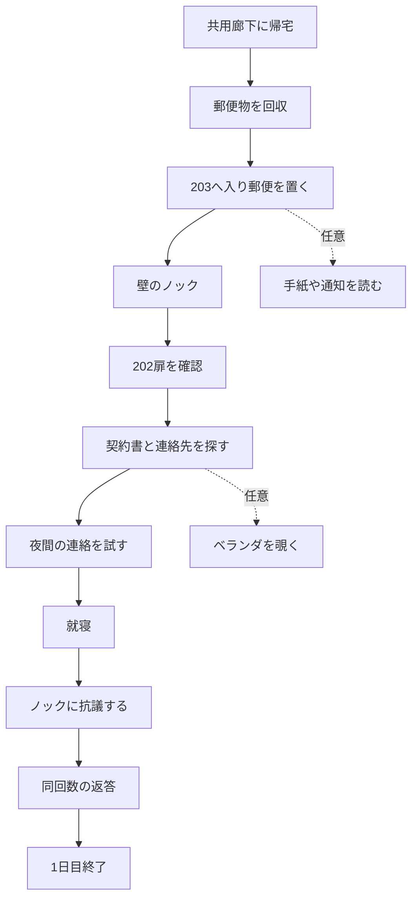

# 05. イベント・状態・セーブ設計

## ルール

- **状態（フラグ）**は世界の進行だけを表す。怪異の真相を表すフラグを作らない。
- 同じイベントは意図せず二重発火させない。
- イベントの開始条件・完了条件・中断可否を分ける。
- 日付の切替はベッドイベント完了後のみ。自由な時計経過で強制しない。

## 1日目の状態遷移



**補足**：C→Dの発火は「郵便を置いた」直後ではなく、短い探索時間または机を離れるなどの条件を用い、必ず発火するフォールバックを用意する。ベランダを必須化しない。

## イベントデータ契約（提案）

| ID | 発火条件 | 結果 | 再発火 |
|---|---|---|---|
| `evt_mail_pickup` | 郵便受けにE | 郵便取得 | 不可 |
| `evt_mail_place` | 取得後、机にE | 書類閲覧解放 | 不可 |
| `evt_first_knock` | 郵便設置＋室内探索 | ノック再生、目的更新 | 不可 |
| `evt_202_door` | 初回ノック後、202扉にE | 無応答、次目標解放 | 初回のみ |
| `evt_contract` | 202確認後、書類にE | 連絡先解放 | 閲覧は何度でも |
| `evt_call_after_hours` | 連絡先発見後、スマホで発信 | 夜間案内 | 初回のみ |
| `evt_sleep_day1` | 連絡試行後、ベッドにE | ノック応答→フェード | 不可 |

## フラグ命名

```text
day_index: int = 1
mail_collected: bool
mail_placed: bool
letter_read: bool
power_cut_notice_seen: bool
first_knock_heard: bool
neighbor_door_checked: bool
contract_found: bool
contact_attempted: bool
balcony_visited: bool
balcony_oddity_seen: bool
day1_complete: bool
power_disconnected: bool
phone_call_started: bool
phone_clue_reviewable: bool
shelf_shifted: bool
inspection_hatch_found: bool
old_plan_found: bool
hatch_opened: bool
final_sleep_started: bool
epilogue_started: bool
```

## 2〜3日目のゲート（概要）

- **2日目開始**：`day_index=2` → `power_disconnected=true`。通常照明を使えず、スマホライトを利用可。
- **電話イベント**：管理会社へ連絡 → 保留 → ノック → 声が歪む → 通話終了 → `phone_clue_reviewable=true`。
- **3日目開始**：`day_index=3` → `shelf_shifted=true`。棚を調べると点検口の存在が分かる。
- **点検口**：図面・道具の調査後に開く。開いたことは進行条件であり**死の原因を意味しない**。
- **終幕**：就寝→呼吸が聞こえなくなる→暗転→郵便受け→最後のノック。

## セーブ設計

- **プロトタイプ**：タイトルから開始＋章の最初から再開で十分。途中セーブは後続で追加。
- **全編**：日付開始時オートセーブ、任意の中断再開を目標。`ConfigFile`またはJSONでバージョン付き保存。
- 保存内容：`save_version`、`day_index`、フラグ、既読文書ID、現在シーンID、オプション。座標保存は必要性を確認してから。
- 再ロード時にワンショット音・イベントが重複しないことをテスト。

## デバッグ機能

開発時のみ現在イベントID・フラグ表示、1日目/2日目/3日目の開始地点へ移動、イベント強制再生。リリース版では無効化。
