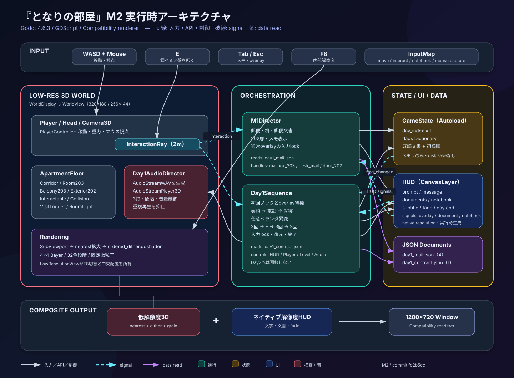
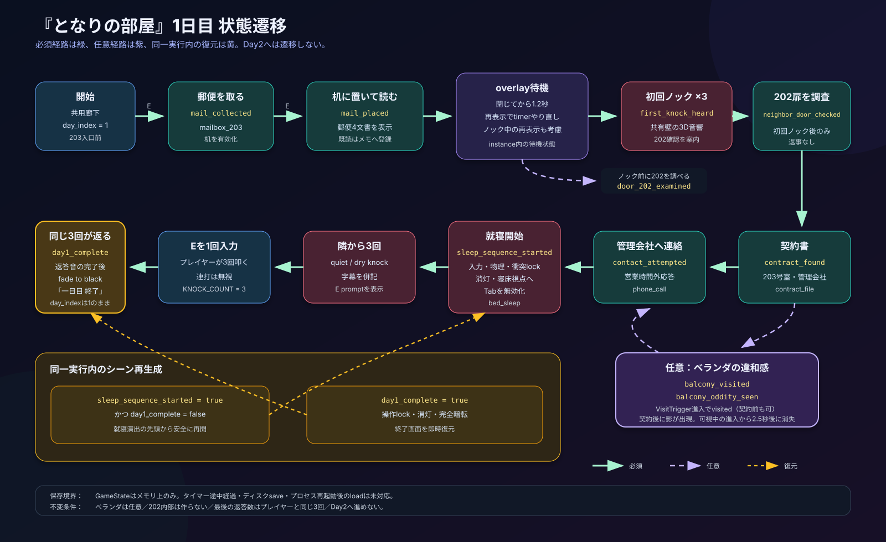

# 08. 使用技術・Godot 4実装アーキテクチャ

この文書は、M2（1日目完結プロトタイプ）時点の実装を説明する。初期設計案ではなく、コミット`fc2b5cc`のシーンとGDScriptを基準にしている。2日目、ディスク保存、タイトル画面など未実装の要素は末尾の「今後の境界」に分ける。

## アーキテクチャ図

### 実行時コンポーネントとデータフロー



### 1日目の状態遷移



SVGは単体でも閲覧できる。

- [`diagrams/runtime_architecture.svg`](diagrams/runtime_architecture.svg)
- [`diagrams/day1_state_flow.svg`](diagrams/day1_state_flow.svg)

## 使用技術

| 分類 | 採用技術 | 現在の用途 |
|---|---|---|
| ゲームエンジン | Godot Engine 4.x | Godot 4.6.3で開発・検証 |
| 言語 | GDScript | プレイヤー、調査、進行、UI、音響、描画制御 |
| 3D描画 | Compatibility renderer | `project.godot`で固定。Forward+は未使用 |
| レベル表現 | Godot標準3Dノード、CSG、StandardMaterial3D | 共用廊下、203号室、ベランダ、202外観、家具 |
| 低解像度描画 | SubViewport + SubViewportContainer | 3Dのみ320×180、F8で256×144へ切替 |
| 拡大 | nearest filtering | 低解像度の画素をぼかさずウィンドウへ拡大 |
| ポストプロセス | CanvasItem shader | ordered dithering、色段階削減、固定微粒子 |
| UI | CanvasLayer + Control | 調査prompt、文書、メモ、字幕、fade、終了表示 |
| データ | JSON | 1日目の郵便4文書と契約書1文書 |
| 音響 | AudioStreamPlayer3D + 実行時生成AudioStreamWAV | 共有壁から聞こえる2音色のノック |
| 検証 | Godot headless、Xvfb、OpenGL llvmpipe | 構文・状態進行・物理・UI座標・実行時画像の確認 |

外部ランタイムライブラリやアセット管理プラグインには依存していない。ゲーム本体はGodotプロジェクトだけで起動できる。

## 現在のディレクトリ

```text
res://
├── project.godot
├── scenes/
│   ├── game_root.tscn
│   ├── levels/apartment_floor.tscn
│   ├── player/player.tscn
│   └── ui/hud.tscn
├── scripts/
│   ├── autoload/game_state.gd
│   ├── interaction/
│   │   ├── interactable.gd
│   │   └── interaction_ray.gd
│   ├── player/player_controller.gd
│   ├── rendering/low_resolution_view.gd
│   ├── systems/
│   │   ├── m1_director.gd
│   │   ├── day1_sequence.gd
│   │   └── day1_audio_director.gd
│   └── ui/hud.gd
├── shaders/ordered_dither.gdshader
└── data/documents/
    ├── day1_mail.json
    └── day1_contract.json
```

初期案にあった`EventDirector`、`DayDirector`、`SaveManager`、独立した`DocumentViewer`、`Notebook`、`PauseMenu`はまだ存在しない。現在は小規模な縦切りプロトタイプとして、1日目の責務を`M1Director`と`Day1Sequence`へ分けている。

## 実行時シーン構造

```text
/root
├── GameState                         # Autoload、メモリ上の状態
└── GameRoot (Control)                # low_resolution_view.gd
    ├── WorldDisplay (SubViewportContainer)
    │   └── WorldView (SubViewport)   # 320×180 / 256×144
    │       ├── ApartmentFloor
    │       ├── Player (CharacterBody3D)
    │       │   ├── CollisionShape3D
    │       │   └── Head
    │       │       └── Camera3D
    │       │           └── InteractionRay (RayCast3D)
    │       └── Day1AudioDirector
    │           └── KnockPlayer       # 実行時生成
    ├── HUD (CanvasLayer)             # UI部品を実行時生成
    ├── M1Director
    └── Day1Sequence
```

3D世界と3D音響は`WorldView`内に置く。HUDと進行Directorは低解像度SubViewportの外に置くため、文字はネイティブ解像度で描画され、ディザリングの影響を受けない。

## モジュールの責務

| モジュール | 現在の責務 | 境界 |
|---|---|---|
| `GameState` | `day_index`、進行flag、既読文書、初読順をメモリに保持 | UI、音、レベルノードを直接操作しない |
| `PlayerController` | WASD移動、重力、マウス視点、入力有効／無効 | シナリオ条件を判定しない |
| `Interactable` | `interaction_id`、表示文、利用可否を持つ調査対象 | 進行flagを直接変更しない |
| `InteractionRay` | 2m以内の対象検出、通常時のE入力、promptとinteractionのsignal発行 | 対象IDごとの物語処理を持たない |
| `M1Director` | 郵便回収・机への設置、郵便文書、通常／ノック後の202扉、メモ、通常overlayの入力停止 | 就寝後の演出や音響を扱わない |
| `Day1Sequence` | 初回ノック、契約、電話、任意ベランダ、就寝、壁応答、終了、同一実行内の復元 | 2日目へ進めない |
| `Day1AudioDirector` | ノック波形生成、3D再生、回数・間隔・音量、重複防止 | flagやHUDを変更しない |
| `HUD` | prompt、message、文書、メモ、字幕、fade、終了表示 | 文書IDの意味や進行条件を判定しない |
| `LowResolutionView` | 内部解像度切替、アスペクト比を保った拡大・中央配置 | HUDを低解像度化しない |
| `ApartmentFloor` | 空間、衝突、照明、調査対象、ベランダtrigger、任意の影 | 進行ロジックをスクリプトとして持たない |

## 入力とsignalの流れ

通常の調査は次の順で処理する。

1. `InteractionRay`が物理フレームごとにcolliderから親をたどり、利用可能な`Interactable`を探す。
2. 対象が変わると`prompt_changed(prompt)`を発行し、`M1Director`が`HUD.set_interaction_prompt()`へ渡す。
3. E入力で`interaction_requested(target)`を発行する。
4. `M1Director`と`Day1Sequence`が同じsignalを受け、担当する`interaction_id`だけを処理する。
5. `InteractionRay`はsignalの後に`target.interact()`を呼ぶ。現在の`Interactable.interacted`は引数なしで、1日目進行では直接利用していない。

主要なsignal契約は以下。

| 発行元 | signal | 主な受信先 | 用途 |
|---|---|---|---|
| `InteractionRay` | `prompt_changed(String)` | `M1Director`→`HUD` | 通常調査prompt |
| `InteractionRay` | `interaction_requested(Interactable)` | `M1Director`、`Day1Sequence` | ID別の調査処理 |
| `HUD` | `overlay_opened` / `overlay_closed` | `M1Director`、一部`Day1Sequence` | 入力停止とノック待機 |
| `HUD` | `document_viewed(StringName)` | 両Director | 担当文書の既読登録 |
| `HUD` | `notebook_requested` | `M1Director` | 既読文書一覧の表示 |
| `GameState` | `flag_changed(StringName, bool)` | `Day1Sequence` | 対象のenabled／visible更新とイベント予約 |
| `Balcony203/VisitTrigger` | `body_entered(Node3D)` | `Day1Sequence` | 任意ベランダイベント |

`GameState.document_read`も発行されるが、M2時点では受信側を持たない。将来、実績・セーブ・分析などを追加するときの接続点にできる。

## 入力ロックの所有権

入力競合を避けるため、通常overlayと就寝演出で所有者を分けている。

- 文書・メモを開いたときは`M1Director`がPlayerとInteractionRayを停止する。
- 通常overlayを閉じると`M1Director`が入力を戻す。
- `sleep_sequence_started`または`day1_complete`の後は、overlayを閉じても`M1Director`は入力を戻さない。
- 就寝開始時は`Day1Sequence`がPlayer入力、Player物理処理、Player衝突、InteractionRay、Tabメモを停止する。
- 就寝後に必要なE入力だけは`Day1Sequence`が受け、一度のEでプレイヤー側の3回ノックを開始する。
- HUDの`_input`、PlayerとInteractionRayの`_unhandled_input`を用途に応じて使い分ける。
- F8の内部解像度切替はInputMapではなく`LowResolutionView`がキーを直接処理する。

この分担を変更するときは、「誰がロックしたか」と「どの状態で解除可能か」を同時に更新する。

## 状態管理

`GameState`は唯一のAutoloadで、同じプロセス内ではシーンを再生成しても残る。現在の状態はディスクへ保存されない。

### 主進行flag

| flag | 意味 |
|---|---|
| `mail_collected` | 203郵便受けから郵便物を回収 |
| `mail_placed` | 机に郵便物を置き、文書表示を開始 |
| `first_knock_heard` | 初回の3回ノックが完了 |
| `neighbor_door_checked` | 初回ノック後に202扉を確認 |
| `contract_found` | 203の契約書を確認 |
| `contact_attempted` | 管理会社へ営業時間外に連絡 |
| `sleep_sequence_started` | 就寝演出を開始 |
| `day1_complete` | 最後の同数返答が完了 |

### 補助・任意flag

| flag | 意味 | 主進行への影響 |
|---|---|---|
| `door_202_examined` | 初回ノック前に202扉を調査 | なし |
| `letter_read` | 差出人不明の手紙を表示 | なし |
| `power_cut_notice_seen` | 電気停止通知を表示 | なし |
| `balcony_visited` | 203ベランダへ進入 | なし |
| `balcony_oddity_seen` | 隣窓の任意の影を観察 | なし |

既読文書は`read_documents`辞書へIDをキーとして文書の複製を保持し、`read_document_order`へ初読順を残す。これにより同じ文書を読み直してもメモ一覧が重複しない。

## 1日目シーケンスの技術的条件

- `mail_placed`後、文書やメモが閉じてから1.2秒待って初回ノックを鳴らす。
- 待機中にoverlayが再度開いた場合、閉じた時点から待機をやり直す。
- ノック再生中にoverlayが開いた場合、202確認の案内はoverlayが閉じるまで待つ。
- 初回ノック前の202調査は`door_202_examined`、後の調査は`neighbor_door_checked`として区別する。
- 契約書→営業時間外連絡→就寝が必須経路。ベランダは任意経路で、未訪問でも進行できる。
- 就寝後は隣が3回、E入力後にプレイヤーが3回、隣が同じ3回を返す。
- `day1_complete`は最後の返答音が終わった時点で立ち、その後に暗転と終了表示を行う。
- `day_index`は1のまま維持し、2日目へは遷移しない。

### 同一実行内の復元

- `sleep_sequence_started=true`かつ未完了でシーンを作り直した場合、就寝演出の先頭から安全に再開する。
- `day1_complete=true`で作り直した場合、操作をロックし、消灯した寝床視点、完全暗転、終了表示を即座に復元する。
- 初回ノック前の待機中など、インスタンス内だけのtimer進捗は保存しない。

これはクラッシュ復旧やゲーム再起動後のloadではない。SaveManagerは未実装である。

## 描画パイプライン

```text
ApartmentFloor + Player + 3D Lighting
                ↓
       WorldView SubViewport
         320×180 / 256×144
                ↓
       WorldDisplay nearest拡大
                ↓
 ordered_dither.gdshader（3Dのみ）
                ↓
     ウィンドウへ中央配置・余白

HUD CanvasLayer ─────────────────→ ネイティブ解像度で合成
```

`LowResolutionView`は内部描画の16:9を保ってWorldDisplayをウィンドウ内で最大化し、中央へ置く。整数倍率には限定していない。たとえば640×480では3D表示が640×360になり、上下に60pxずつ余白ができる。

シェーダーは4×4 Bayerパターン、各色32段階の量子化、時間に依存しない固定の微粒子を使う。UIへは適用しない。

HUDは`hud.gd`がControlを実行時生成する。CanvasLayer直下のControlは自動ではviewportサイズにならないため、初期化時と`viewport.size_changed`時にルートサイズを同期する。この処理を外すと中央promptやoverlayが左上へずれる。

## 文書データ

`day1_mail.json`と`day1_contract.json`は次の配列形式。

```json
[
  {
    "id": "document_id",
    "title": "表示タイトル",
    "body": "本文"
  }
]
```

M2時点で外部化しているのは文書本文だけである。字幕、電話応答、ノック回数・時間、共有壁座標はGDScript内にある。JSON schema検証やlocalization層は未実装。

## 音響

`Day1AudioDirector`は外部音声ファイルを使わず、起動時に2種類の短いノック波形を生成する。

- 22,050Hz、16bit、モノラル、1打85ms。
- 減衰する基音・倍音と固定seedの短いnoiseを合成。
- `AudioStreamPlayer3D`を共有壁のworld座標へ置いて再生。
- 再生中の追加要求は重ねずに無視する。
- 指定音量は最大-6dBに制限し、1日目では-13〜-15dBを使用。
- tone variantでプレイヤー側と隣室側をわずかに変える。

環境音、通話音声、通話加工、専用Audio Busは未実装。管理会社への連絡は文字表示で、音声は鳴らさない。

## 検証と限界

現在までに次を確認している。

- Godot 4.6.3 headlessでメインsceneが起動する。
- 郵便→初回ノック→202→契約→連絡→就寝→同数返答→終了を通せる。
- ベランダを省略しても完了できる。
- overlayと初回ノックの競合、就寝中のTab、E連打を防ぐ。
- 就寝途中と完了後の同一実行内復元が成立する。
- 主要Interactableが2m以内でrayに当たり、ベランダ導線と202遮断を維持する。
- 640×480と1280×720でHUDがviewport内に収まる。
- Xvfb + OpenGL llvmpipeで低解像度描画、dithering、寝床promptを確認する。
- ノック波形のpeak、間隔、同時再生防止を自動確認する。

これらの一時検証scriptはリポジトリへ収録していない。headless検証は音の体感や最終的な画質を保証せず、llvmpipeはsoftware rendererである。実GPU・実音響機器・長時間playでの確認は残る。

## 現在の結合点と変更時の注意

- 両Directorは固定NodePathでGameRoot、Player、HUD、level内nodeを参照する。node名変更時はGDScriptも更新する。
- `M1Director`と`Day1Sequence`は同じ`interaction_requested`を受ける。新しいIDは一方だけが所有する。
- HUDは単一scriptで全文書UIを生成する。見た目の反復調整が増えたら、文書、メモ、字幕、fadeを個別sceneへ分ける。
- `ApartmentFloor`は1つの大きなsceneで、CSG形状と小物を含む。2日目の差分が増えたら、Room203、Corridor、Balconyや日別propsを分離する。
- 状態flagは文字列IDである。追加時は状態遷移図と決定logも更新する。

## 今後の境界

次の段階では、機能追加と同時に責務を整理する。

1. **Day2実装前**：`Day1Sequence`を日別Directorの共通interfaceへ寄せ、日付遷移の所有者を決める。
2. **save導入前**：flagのschema、version、再開可能なcheckpointを定義してから`SaveManager`を追加する。
3. **UI拡張前**：手続き生成HUDを必要単位のPackedSceneへ分離し、focusと入力modeを明示する。
4. **音響拡張前**：環境音・効果音・通話用Audio Busを設計し、音量基準を統一する。
5. **data拡張前**：JSON schema、読み込みerror表示、localization keyを導入する。
6. **自動化強化**：状態遷移とUI競合の回帰testをリポジトリへ保存し、再現可能にする。

作品方針として、202号室内部はscene化しない。怪異の正体を説明するdata modelも追加しない。
