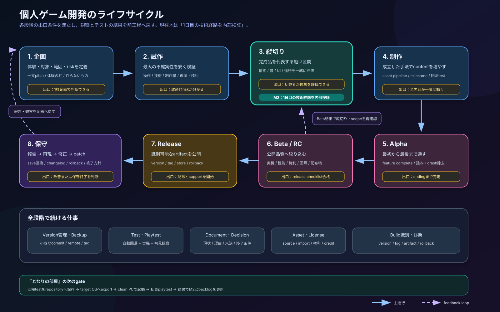

# 12. 個人ゲーム開発ガイド — 環境構築からリリース・保守まで

この文書は、個人または小人数でゲームを完成・配布・保守するための実践ガイドである。一般的な方法を説明しつつ、『となりの部屋』M2（1日目完結プロトタイプ）の現状と比較する。

企業向けの重い工程をそのまま導入するのではなく、1人でも継続できる最小構成を優先する。ストア規約、料金、審査、SDK要件は変わるため、公開直前に必ず各公式資料を確認する。

## 現在地

『となりの部屋』は、企画とアート方針があり、歩行・調査・文書・ノック・1日目終了までを実行できる**縦切り型の1日目プロトタイプ**である。完成品質の縦切りには未到達だが、主要な技術経路は内部検証済みである。

一方、次の状態にはまだ達していない。

- 初見プレイヤーによる体験評価済みデモ
- 別PCへ渡せる再現可能な配布build
- 3日間を完走できるfeature complete版
- ストア公開可能なrelease candidate
- save互換やpatch手順を備えた運用中製品

「動く」と「面白さを確認できた」と「配布できる」と「保守できる」は別の完成条件として扱う。

### 本文で使う用語

| 用語 | この文書での意味 |
|---|---|
| risk（リスク） | 未解決の不確実性。単なる危険だけでなく、面白さや制作量が未確認な状態も含む |
| build（ビルド） | editor外で実行・配布できる形に出力したゲーム |
| artifact（成果物） | version付きで保存したbuild、記号、log、check結果など |
| gate／出口条件 | 次の段階へ進むために満たす条件 |
| feature complete | 予定した機能が一通り実装され、追加より修正を優先する状態 |
| triage | 報告の再現性、影響、優先度を整理すること |
| CI（継続的integration） | commitごとなどにtestやbuildを自動実行する仕組み |

## 開発ライフサイクル



SVG単体：[`diagrams/indie_game_lifecycle.svg`](diagrams/indie_game_lifecycle.svg)

| 段階 | 主な目的 | 出口条件の例 |
|---|---|---|
| 企画 | 誰にどんな体験を渡すか決める | 1枚企画と「作らないもの」を説明できる |
| 試作 | 最大の不確実性を安く検証する | 操作・技術・体験の致命的な問題が分かる |
| 縦切り | 完成品を代表する短い区間を作る | 初見者が導線を理解し、狙った体験を評価できる |
| 制作 | 内容と素材を増やす | 全機能・全contentが一度は通る |
| Alpha | 最初から最後まで通す | feature complete、既知の詰みを除去 |
| Beta / RC | 公開品質へ絞り込む | 対応環境、権利、performance、回帰、配布物を確認 |
| Release | 安全に公開する | version付き配布物を公開し、問い合わせ受付を開始できる |
| 保守 | 不具合修正と互換性維持 | 受付、triage、patch、履歴、終了方針を運用できる |

進行は一方向ではない。テストと観察の結果で、範囲、仕様、優先順位を前段へ戻して更新する。

---

## 1. 完成の定義と企画

### 一般的な考え方

最初に決めるのは機能一覧ではなく、プレイヤーへ渡す体験である。短い企画書には次を含める。

- 一文で説明できる作品の核
- 対象プレイヤーと想定play時間
- 対応platformと操作機器
- 体験の柱を2〜4個
- 完成に必須の要素
- 入れない要素と削る順番
- 最大の技術・制作・権利リスク
- prototype、demo、製品版それぞれの完成条件

「ホラーゲームを作る」では広すぎる。「日常の部屋が3夜で少しずつ変わり、見えない隣室を音で恐れる45〜60分の一人称作品」のように、体験と制約を同時に述べる。

### 個人開発の最小構成

1. 1枚企画を作る。
2. 必須、できれば、入れない、の3分類にする。
3. 最も危険な仮説を3つ以内に絞る。
4. 各仮説を確認する最小prototypeを決める。

企画書を長くするより、「何を確認できれば次へ進むか」を明確にする。

### 『となりの部屋』との比較

| 項目 | 現状 | 評価 |
|---|---|---|
| 作品の核 | 静かな心理ホラー、見えない202、3日間 | 明確 |
| 対象時間 | 45〜60分、1日目は10〜15分想定 | 定義済み |
| 禁止事項 | 202内部、戦闘・追跡、説明過多を避ける | scope管理に有効 |
| 縦切り | 1日目をM2として実装 | 技術経路は成立 |
| 体験の証拠 | 自動・内部検証が中心 | 初見者の怖さ・迷い・所要時間は未確認 |

次の内容拡張前に、初見者が1日目をどう理解するかを観察する価値が高い。

### 成果物と出口条件

- 1枚企画
- 対象、対応platform、想定時間
- やらないこと一覧
- prototypeで確認する仮説
- 「次へ進む／作り直す／中止する」の判断条件

---

## 2. 開発環境と再現性

### 一般的な考え方

開発環境は、作者のPCで一度動けばよいものではない。数か月後の自分、別PC、配布build環境でも再現できる必要がある。

記録する項目は次のとおり。

- engine名と検証version
- renderer、target OS、CPU architecture
- 必要なexport template、SDK、外部tool
- projectの開き方と実行方法
- source assetを編集するtoolとversion
- build/export command
- 秘密情報の保管場所と、repositoryへ入れないもの
- clean checkoutから起動する手順

### Version管理

Gitにはcodeだけでなく、scene、設定、document、small assetを含める。大きなbinary assetが増えたらGit LFS等を検討する。

最小の運用は次でよい。

- `main`または`master`を常に起動可能に保つ。
- 1つの変更目的ごとにcommitする。
- 大きな変更は短命branchで行う。
- release候補にはtagを付ける。
- repository以外にもremote backupを持つ。
- generated cache、local editor state、secretはignoreする。

branchを増やしすぎるより、変更を小さくし、頻繁に統合するほうが個人開発では管理しやすい。

### BackupはGitと別物

Gitは誤変更から戻す仕組みで、PC故障やaccount喪失への完全なbackupではない。remote repository、定期的な別媒体backup、source assetのbackupを分けて考える。

### 『となりの部屋』との比較

| 項目 | 現状 | 次の改善 |
|---|---|---|
| Engine | Godot 4.x、4.6.3で検証 | version取得先とexport templateを記録 |
| Renderer | Compatibility固定 | target PCでの実GPU確認 |
| 起動手順 | READMEにF5／CLIを記載 | clean checkout手順を別環境で実行 |
| 外部依存 | runtime依存なし | asset制作tool導入時に追記 |
| Version管理 | 段階的なGit履歴あり | remote backupとrelease tagを運用 |
| Build再現 | editor実行は可能 | `export_presets.cfg`とbuild commandが未整備 |

### 成果物と出口条件

- `README`のsetup・run・build手順
- engine versionとtarget OS
- `.gitignore`、必要ならLFS設定
- clean checkoutから起動できること
- backup先と復旧手順
- secretを含めない確認

---

## 3. 開発手法：小さく作って観察する

### Risk-first prototype

prototypeは完成品を小さくしたものではなく、不確実性を確認するための使い捨ても許される実験である。

代表的なriskは次の4種。

- **体験risk**：本当に怖い、気持ちよい、分かりやすいか
- **技術risk**：描画、AI、network、save等が成立するか
- **制作risk**：必要なasset量を1人で作れるか
- **市場・権利risk**：届けたい相手、platform、素材権利が成立するか

本作では、低解像度3Dの見え方、1日目の導線、ノックの怖さ、同じ部屋の変化が主要なriskになる。

### Greybox → Vertical slice → Production

1. **Greybox**：primitiveと仮UIで距離、導線、操作を確認する。
2. **Vertical slice**：短い区間だけ、最終品質に近い描画・音・UI・進行をそろえる。
3. **Production**：縦切りで成立した作り方を使い、contentを増やす。

縦切り前に大量のcontentを作ると、操作やpipeline変更で作り直しが増える。

### 日常のtask管理

taskは半日〜2日程度で、結果を確認できる単位にする。

悪い例：

- 部屋を完成させる
- 音を良くする
- bugを直す

良い例：

- 203入口から机まで遮られず移動できるcollisionを作る
- 共有壁から3回の乾いたノックを-15dBで鳴らし、字幕を同時表示する
- 文書中にノックが発火しない再現testを追加する

### Definition of Done

個々のtaskは、codeを書いた時点では終わらない。最小の完了条件を決める。

- 目的を満たす
- 主要な失敗経路を確認する
- errorやwarningを増やさない
- document・decision・asset台帳を必要に応じて更新する
- 再現手順またはtestを残す
- 自己確認を行い、他者reviewを実施した場合は指摘を解消する

### 『となりの部屋』との比較

M0（歩く）→M1（調べる）→M2（1日目完結）は、riskを段階的に下げる良い構成である。レビュー→差し戻し→再レビューも品質を上げている。

改善点は、`09_asset_and_task_backlog.md`のcheckboxが実装状況に追従していないこと、M2の「初見者が10〜15分で完走」という体験条件が未確認なことである。実装済み、内部検証済み、外部検証済みを分けると判断しやすい。

### 成果物と出口条件

- milestoneと各出口条件
- 半日〜2日のbacklog
- Definition of Done
- decision log
- playtestで検証する仮説

---

## 4. 設計と実装

### 責務を分ける

小規模projectでも、次は分ける価値がある。

- 入力とplayer movement
- world objectとinteraction検出
- game state
- event sequence
- UI表示
- audio
- external data
- save/load

分割の目的はfile数を増やすことではなく、変更の影響範囲を小さくすることにある。

### 状態を明示する

物語gameでは、scene内の見た目だけで進行を判断すると再開・debug・testが難しくなる。状態には安定したIDを付け、必須、任意、一時演出を区別する。

```text
永続候補: mail_collected, contract_found, day1_complete
任意記録: balcony_oddity_seen
一時状態: timer進捗, audio再生中, 現在のfade率
```

saveへ入れる状態と、再生成できる一時状態を分ける。

### Data-driven設計

台詞、文書、item、balance値など、頻繁に編集する内容はdataへ分ける。ただし全てを外部化する必要はない。

外部化の判断基準：

- codeを触らず内容を編集したい
- localization対象になる
- 同じschemaの件数が増える
- designerやwriterが編集する
- validationやtool化の価値がある

### Errorとlogging

個人開発でも、最低限次を残す。

- 読み込み失敗は無言で無視しない
- 重要な状態遷移にはdebug logを出す
- build versionを確認できるようにする
- user報告で取得するlog場所をdocument化する
- release版で残すlogとdebug専用logを決める

### 『となりの部屋』との比較

詳細は[使用技術・実装アーキテクチャ](08_godot_architecture.md)と[実行時図](diagrams/runtime_architecture.svg)を参照。

強み：

- `GameState`、interaction、進行、HUD、audioの責務が分かれている。
- 3Dとnative UIの描画境界が明確。
- 郵便文書と契約書をJSON化している。
- Day1の状態遷移と入力lockをdocument化している。

課題：

- `GameState`はmemoryのみで、process終了後のsave/loadはない。
- Directorは固定NodePathへ依存する。
- HUDは単一scriptで実行時生成している。
- JSON schemaとlocalization層がない。
- 配布版を識別するgame versionがない。

### 成果物と出口条件

個人開発の最小構成：

- 主要なruntime構成と状態遷移の説明
- moduleの責務と所有者
- 件数や編集者が増えるdataのschema
- error処理方針
- save対象と一時状態の分類
- 重要な変更のdecision record

小規模な実験段階では、全dataのschema化や詳細な図を義務にしない。再利用、共同編集、save互換、変更影響が増えた箇所から形式化する。

---

## 5. Asset、Audio、UIの制作pipeline

### SourceとGame用assetを分ける

編集可能なsourceと、engineへimportするgame用fileを区別する。

```text
source: Blender, Krita, DAW project, layered image
game:   glTF/GLB, PNG/WebP, WAV/OGG, font
```

sourceを残すと、後で色、scale、loop、圧縮を修正できる。game用fileだけでは再編集できない場合がある。

### 命名とimport rule

- unit、scale、原点、向きを統一する
- texture sizeとfilterを用途別に決める
- audio sample rate、loudness、loop点を決める
- file名は意味とvariantが分かるようにする
- import設定の例外を記録する
- performance budgetを決める

### 権利台帳

外部assetを1つでも使うなら、入手時に記録する。公開直前に思い出そうとすると漏れる。

| 項目 | 内容 |
|---|---|
| Asset ID | project内の安定した識別子 |
| 名称・file | 何をどこで使うか |
| 作者・入手先 | URLや購入記録 |
| License | 商用利用、改変、再配布、credit条件 |
| 取得日・version | 規約変更に備える |
| 変更内容 | crop、加工、mixなど |
| Credit文 | 公開時にそのまま転記できる文 |

### UIとAccessibility

最低限確認する。

- 文字が背景や低解像度効果に潰れない
- 音だけの必須情報へ字幕・視覚補助がある
- 入力を変更できるか、少なくとも明示する
- 感度、音量、明るさ、字幕sizeの必要性を評価する
- 操作不能が演出か不具合か分かる
- flashing、motion sickness、強い音への配慮を検討する

### 『となりの部屋』との比較

- 3DはCSGと標準material中心で、外部asset依存が小さい。
- 低解像度3Dとnative UIを分け、文字の可読性を守っている。
- 必須ノックへ字幕を付けている。
- ノック音はproceduralな仮実装で、環境音や通話音声は未実装。
- asset台帳はあるが、作者・license・取得日・credit欄はまだない。
- FOV、mouse感度、音量、明るさ、字幕sizeの設定UIはない。

外部asset導入前に権利台帳の列を増やすと、後のrelease作業が軽くなる。

### 成果物と出口条件

個人開発の最小構成：

- 今回必要なasset一覧と、仮素材／最終素材の区別
- 採用済みassetの権利台帳
- 必須情報の可読性、字幕、音量の確認結果
- 再編集可能なsource fileの保管場所

素材が増えた場合は、命名規約、import preset、polygon・texture・audioのbudget、自動変換を追加する。小規模な仮素材だけの段階では、複雑なasset管理toolは必須ではない。

---

## 6. テストとPlaytest

### テストは目的で分ける

| 種類 | 確認すること | 自動化 | 頻度 |
|---|---|---|---|
| Static／import | parse error、missing resource、壊れたdata | 高 | 毎変更 |
| Logic | 状態条件、count、data変換 | 高 | 毎変更 |
| Scene／component | node path、signal、collision、UI座標 | 中 | 関連変更時 |
| Integration | 開始から重要eventまでの流れ | 中 | milestone／merge前 |
| Smoke | 起動、new game、操作、終了 | 中 | buildごと |
| Manual feel | 操作感、怖さ、音量、読みやすさ | 低 | 定期 |
| First-time playtest | 誘導、理解、迷い、所要時間 | 不可 | 縦切り／beta |
| Compatibility | OS、GPU、解像度、入力機器 | 一部 | release前 |
| Performance | frame time、memory、loading | 一部 | milestone／release前 |
| Accessibility | 字幕、contrast、motion、audio代替 | 一部 | UI・演出変更時 |

自動testは「面白いか」を判定できない。manual testは毎回同じ状態を正確に確認するのが苦手である。両方を組み合わせる。

### Game特有の境界test

- 必須eventを順番どおり／一部を先回りして調べる
- 任意eventを見ない
- overlayを開閉しながらeventを発火する
- 入力を連打する
- event途中でscene reload、pause、window focus変更を行う
- 解像度、aspect ratio、DPIを変える
- 音量0、deviceなし、低fpsで進める
- saveを旧versionからloadする
- controller抜き差しやkeyboard layout差を確認する

### First-time playtest

作者は正解を知っているため、導線testの代わりにならない。testerへ操作以外を説明せず、次を記録する。

- 完走できたか、所要時間
- 最初に迷った場所
- 見落とした必須・任意要素
- 声に出した解釈
- 怖さ、退屈、驚きの時刻
- 文字、暗さ、音量、酔い
- 作者の想定と違った行動

質問はplay後に行う。途中で助けた場合は、その場所自体を問題として記録する。

### Bug reportの最小項目

```text
Title:
Build version / commit:
OS / GPU / input device:
Severity:
Precondition:
Steps to reproduce:
Expected:
Actual:
Frequency:
Screenshot / video / log:
Workaround:
```

Severity例：

- S0：data loss、security、起動不能、多数へ致命的
- S1：進行不能、crash、回避困難
- S2：機能不良、分かりにくさ、回避可能
- S3：見た目、文言、軽微な違和感

### 『となりの部屋』との比較

確認済み：

- Day1の必須経路と任意ベランダ省略
- overlayとノックの競合
- 就寝中のTab、E連打
- 就寝途中・完了後の同一実行内復元
- ray距離、collision、HUDの複数解像度
- llvmpipe上のOpenGL実行時画像
- ノック波形、peak、間隔、重複抑止

不足：

- 一時test scriptがrepositoryへ入っていない
- CIがない
- 実GPU・実mouse操作・実音響機器の確認がない
- 初見者による10〜15分完走の記録がない
- target OS、複数PC、controllerのmatrixがない
- process終了後のsave/load testは機能自体が未実装

最優先は、既に価値が証明された回帰testを少数だけrepositoryへ保存することである。

### 成果物と出口条件

個人開発の最小構成：

- 起動から主要経路までの手動smoke test
- 壊れやすい重要経路の少数の回帰test
- 未解決bugと回避策の一覧
- 初見playtestの観察記録

同じ確認を繰り返す、複数環境へ配布する、共同開発する段階でCI、性能計測の自動化、対応環境matrixを追加する。初期から全項目を自動化する必要はない。

---

## 7. Build、配布、Release

### Editor実行と配布buildは別物

editorで動くprojectが、そのままuserへ渡せるとは限らない。配布には次が必要。

- target OSとarchitecture
- engine export template
- export preset
- application名、icon、version
- debug／releaseの切替
- 含めるfileと除外するfile
- executableとdataの配置
- clean machineでの起動確認

### 再現可能なbuildの最小構成とCI

最小条件は、document化した手動手順から同じtargetのbuildを再作成でき、重要なsmoke testを実行できることである。CIは最初から必須ではない。

build回数が増えたら、小さなCIへ次を移す。

1. repositoryをcheckoutする。
2. 固定versionのengineを用意する。
3. headless起動・parse・重要testを実行する。
4. target buildをexportする。
5. artifactへversionとcommitを付ける。

最初から全platformをbuildする必要はない。外部playtestのtargetを1つ決め、手順を安定させてから増やす。

### Versionとchannel

配布物には一意なversionを付ける。

例：

```text
0.2.0-dev.3   内部・開発中
0.2.0-demo.1  外部playtest
0.9.0-rc.1    release candidate
1.0.0         初回公開
1.0.1         bug fix
```

厳密なSemantic Versioningを守ることより、buildを一意に識別し、どのcommitと設定から作ったか追えることが重要である。

### Release channel

- 開発者だけのlocal build
- 少人数のclosed playtest
- 公開demo
- release candidate
- public release
- patch／rollback

channelごとにdata互換、debug log、配布先、feedback受付を決める。

### 権利・表示・Store

公開前に確認する。

- game codeとprojectのlicense方針
- engineのlicenseと必要な表示
- asset、font、audio、pluginのlicense
- privacy、telemetry、crash reportの説明
- third-party noticeとcredit
- 対応OS、最低／推奨環境
- 言語、字幕、入力機器、save方式
- horror、flashing、強い音などの注意表示
- screenshot、capsule、trailer、説明文

Steam等の登録費用、審査期間、build upload手順、store要件は公開時点の公式資料で確認する。

### Release前の最小gate

- release commitとtagがある
- CIまたはdocument化した手順からbuildできる
- clean machineでinstall／起動／終了できる
- new gameからendingまで通る
- saveを実装している場合はupgrade／削除を確認する
- settingsの保存・upgrade／削除を確認する
- known issueとworkaroundを整理する
- license／creditを確認する
- rollbackできる以前のartifactを保管する
- support窓口とbug report様式を用意する

### 『となりの部屋』との比較

現状はeditor／CLIから起動できるが、`export_presets.cfg`、build script、CI、配布artifact、game version、release tagを確認できない。`10_qa_and_release.md`には公開checklistがあるが、実際のbuild経路は未構築である。

最初の外部playtest前に、対象OSを1つ決めてexportできる状態を作る。大規模なstore準備より先に、別PCへ渡して1日目を実行できることが重要である。

### 成果物と出口条件

個人開発の最小構成：

- target OSを1つ定めたversion付き配布物
- 手動でも再現できるexport手順
- clean環境での起動・終了・主要経路の確認結果
- 採用済みengine／assetの権利確認と必要な表示
- known issueとfeedback受付先

CI、自動export、複数OS、署名、store API連携は、配布頻度や対象platformが増えたときに追加する。

---

## 8. 公開後の保守

### 問い合わせからpatchまで

```text
報告受付
  ↓
version・環境・再現手順を確認
  ↓
再現／影響範囲／severityを判定
  ↓
修正 → 回帰test → release build
  ↓
patch note → 配布 → 監視
  ↓
解決確認／未解決ならrollback
```

### 個人開発の最小support

- 問い合わせ先を1つ決める
- bug templateを公開する
- 対応する言語と返信頻度を明示する
- version、OS、logの取得方法を案内する
- issueを「再現待ち」「修正予定」「仕様」「保留」に分ける
- patch予定を約束しすぎない

### Save互換

save formatは公開後の大きな制約になる。

- save schema versionを持つ
- missing fieldへdefaultを与える
- migrationを一方向で実装する
- 壊れたsaveを上書きしない
- backupを作る
- compatibilityを打ち切るversionを明記する

本編が短くても、毎回最初からを強制するとuser体験へ影響する。どの区切りでsaveするかを作品の長さと演出に合わせて決める。

save機能を持たない短編やdemoではmigrationは不要である。その場合は「終了すると最初から」などの制約を事前に明示する。

### Logging、Crash、Telemetry

最初から大規模serviceは不要である。まず次を取得できればよい。

- game versionとcommit
- OS、GPU、renderer
- error log
- 最後の重要状態
- 再現手順

crash reportingやtelemetryを導入する場合は、収集内容、目的、保存期間、送信先、opt-out、privacy説明を決める。

### Dependencyとsecurity

- engine／plugin更新をrelease直前に一括適用しない
- security修正とfeature更新を分ける
- 更新前後で重要経路を回帰testする
- 古いbuildとsaveのbackupを持つ
- secretをclient buildへ含めない

### 保守終了

個人開発では永続supportを約束できない。終了時期と範囲を決める。

- critical bugのみ対応する期間
- platform更新への追従方針
- 最終対応OS／engine
- serverがある場合の停止方法
- 購入者・playerへの告知

### 『となりの部屋』との比較

現在は未公開で、flagと既読、ノック回数のdebug logはある。build version、release log方針、bug受付、save互換、patch、rollbackは未整備である。

外部playtest開始時点から、version付きbuildとbug templateを使うと、公開後の運用練習になる。

### 成果物と出口条件

個人開発の最小構成：

- 問い合わせ受付先とbug report様式
- version・OS・logの確認方法
- 修正、回帰確認、配布、rollbackの手順
- 更新履歴とknown issue
- 対応範囲と保守終了方針

crash収集service、telemetry、save migration基盤、複数release channelは、game機能と利用者規模に応じて追加する。

---

## 9. 『となりの部屋』の比較scorecard

記号：`●` 実装・運用済み、`◐` 一部あり／内部確認のみ、`○` 未整備。

| 領域 | 状態 | 根拠・現状 | 次の一手 |
|---|:---:|---|---|
| 企画・scope | ● | vision、3日構成、禁止事項、decision log | playtest結果で更新 |
| Milestone | ● | M0〜M5、M2まで実装 | checkboxを現状へ同期 |
| 縦切り | ◐ | 1日目を技術的に完走 | 初見10〜15分と怖さを外部検証 |
| 開発環境 | ◐ | Godot 4.6.3、Compatibility、起動手順 | clean PC、export template、target OS |
| Architecture | ● | 責務、runtime図、state図 | Day2前に日別Director境界を設計 |
| Data管理 | ◐ | 文書JSON、状態flag | schema、localization、validation |
| Asset pipeline | ◐ | 初期台帳、標準asset中心 | source、license、credit、budget欄 |
| Accessibility | ◐ | native UI、ノック字幕 | settings、感度、音量、明るさ、字幕size |
| 自動回帰test | ○ | 一時testで検証、repository未収録 | 重要経路を少数保存 |
| Manual／実機test | ◐ | llvmpipe画像、内部確認 | 実GPU・mouse・audio・別PC |
| First-time playtest | ○ | 記録なし | 観察、時間、迷い、音量評価 |
| Save／Load | ○ | memory内復元のみ | checkpoint、schema、migration |
| Build／Export | ○ | editor／CLI実行のみ | export presetとbuild手順 |
| CI | ○ | 設定なし | 起動・test・1 target export |
| Version／Tag | ○ | commitは識別可能 | game version、tag、artifact名 |
| License／Credit | ○ | 初期asset台帳のみ | LICENSE／NOTICE／CREDITS方針 |
| Release | ○ | checklist案のみ | RC、clean machine、store準備 |
| Maintenance | ○ | debug logのみ | bug受付、patch、rollback、互換方針 |

現在の評価は「公開準備不足」ではなく、**縦切りの次に何を検証すべきかが明確な段階**という意味である。Day2の量産へ進む前に、M2を他者と別環境で再現できるようにすると、以降の作り直しを減らせる。

## 10. 本作向け推奨roadmap

### Phase A：M2を外部playtest可能にする

1. 重要な一時testを`tests/`へ保存する。
2. target OSを1つ決め、Godot 4.6.3のexport presetを作る。
3. game versionを表示・log出力できるようにする。
4. build手順をscriptまたはdocumentにする。
5. license／credit台帳を作り、採用済みengine・素材の条件を確認する。
6. 必要なlicense表示・通知を配布物へ同梱する。
7. clean machineで起動から一日目終了まで確認する。
8. closed playtest用buildとbug templateを配る。

出口条件：作者以外がeditorなしで起動し、1日目を最後までplayし、version付きで問題を報告できる。

### Phase B：体験を評価する

1. 初見testerの画面と発話を観察する。
2. 完走時間、迷い、見落とし、怖さ、音量、酔いを記録する。
3. 誘導の問題と演出の好みを分ける。
4. M2の完了条件とbacklogを更新する。
5. 変更後に同じ観点で再testする。

出口条件：1日目が、狙った時間と理解度で、作品の核を伝えられる。

### Phase C：Day2・Day3を制作する

1. save checkpointとschemaを先に決める。
2. 日別Directorとlevel差分の拡張方針を決める。
3. settings、audio bus、asset pipelineを整える。
4. M2で成立した手法を使いcontentを増やす。
5. 各日を追加するたびに開始→終了のintegration testを増やす。

出口条件：最初からendingまで通り、feature completeになる。

### Phase D：Release candidate

1. contentを固定し、bug・performance・accessibilityへ集中する。
2. target環境matrixで確認する。
3. 追加済みの全素材についてlicense、credit、store素材、説明、注意表示を最終確認する。
4. saveを実装した場合はmigrationを確認し、install、update、uninstall、rollbackを確認する。
5. tag付きartifactを保管する。

出口条件：公開後に致命的問題が出たとき、versionを識別し、修正またはrollbackできる。

---

## 付録A：1枚企画template

```text
Title:
One-line pitch:
Target player:
Platform / input:
Expected play time:

Experience pillars:
1.
2.
3.

Must have:
Nice to have:
Will not do:

Top risks:
1.
2.
3.

Prototype exit criteria:
Vertical slice exit criteria:
Release exit criteria:
```

## 付録B：Task template

```text
Purpose:
Player-visible result:
Scope:
Out of scope:
Acceptance criteria:
Test steps:
Affected files / systems:
Risks:
Documentation to update:
```

## 付録C：Playtest記録template

```text
Build version:
Tester profile / prior knowledge:
Start / end time:
Completed:
Hints given by developer:
First confusion:
Required events missed:
Optional events found:
Scary / dull / surprising moments:
Text / brightness / volume / motion feedback:
Observed actions that differed from expectation:
Top three changes to test next:
```

## 付録D：Release smoke test

```text
[ ] Clean machineへinstall／展開できる
[ ] Versionを確認できる
[ ] 起動し、main menuまたは開始地点へ入る
[ ] Keyboard／mouseまたは対応controllerで操作できる
[ ] New gameから主要eventを通せる
[ ] Save／Loadまたは非対応の説明を確認する
[ ] Audio、subtitle、brightness、resolutionを確認する
[ ] Ending／終了まで進める
[ ] 再起動後のsettingsとsaveを確認する
[ ] Logに新しい重大errorがない
[ ] Credit／license／注意表示を確認する
[ ] Uninstall／file削除の挙動を確認する
```

## 付録E：Release後のpatch checklist

```text
[ ] 対象versionと再現環境を特定
[ ] Severityと影響範囲を判定
[ ] 修正前に再現testを作成または記録
[ ] 修正後に関連回帰testを実行
[ ] 該当する場合はSave互換とsettings migrationを確認
[ ] Clean buildを作成
[ ] Versionとtagを更新
[ ] Patch noteとknown issueを作成
[ ] Rollback artifactを保持
[ ] 配布後に解決を確認
```
